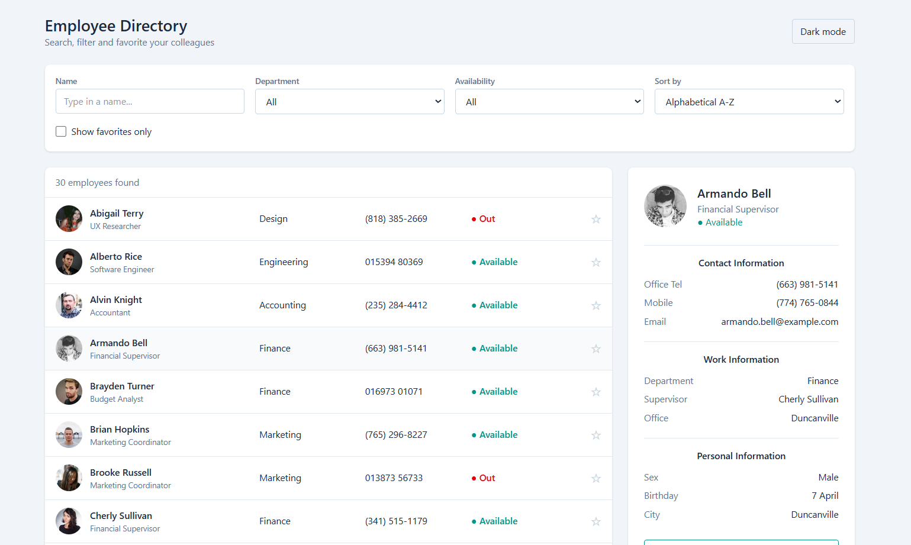
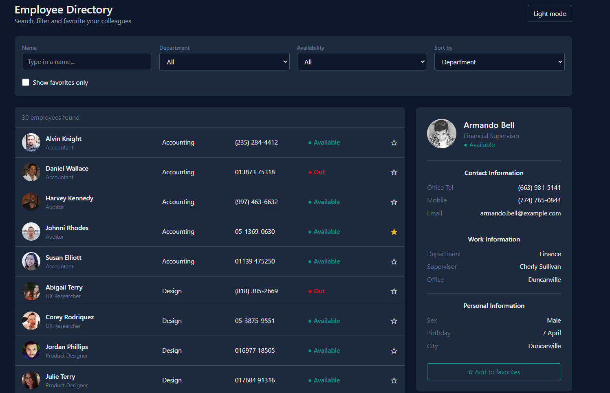
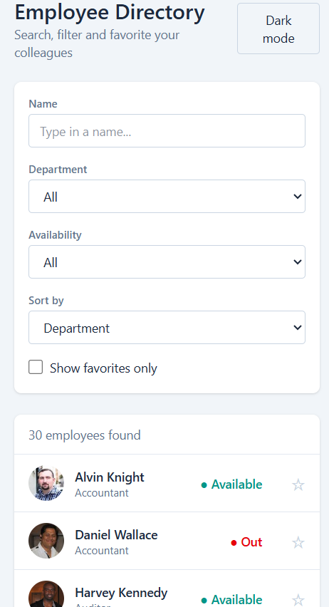
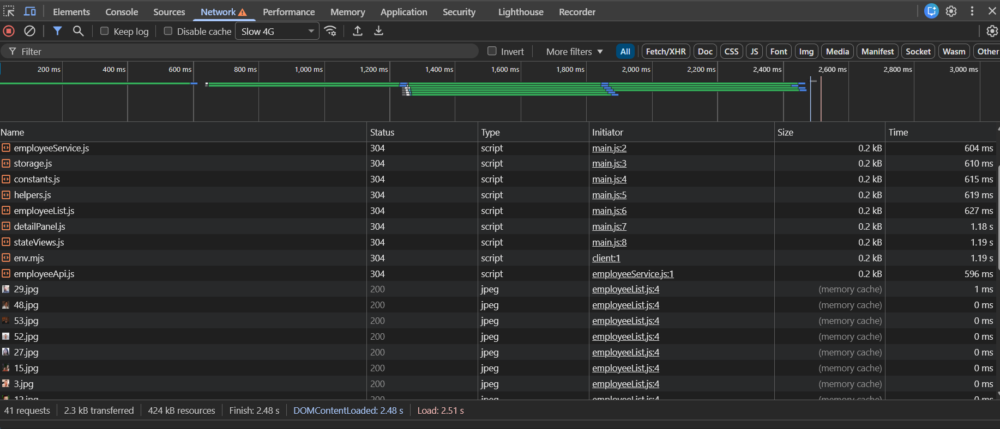
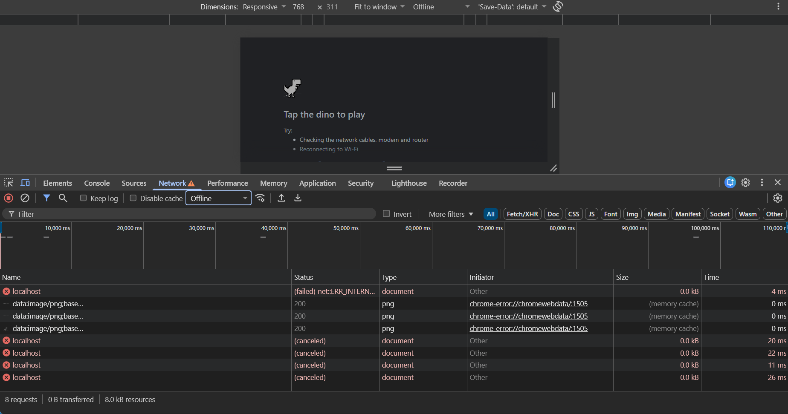
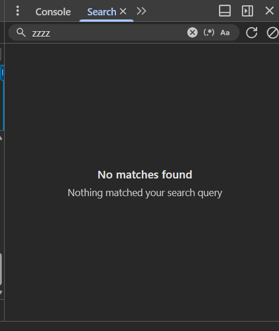

# Interactive Employee Directory

A responsive, accessible Employee Directory web application built with **Vite**, **vanilla JavaScript (ES6+)** and **Tailwind CSS**. It loads employee data from a public REST API using the Fetch API, lets you search, filter, sort and favorite employees, and remembers your preferences in the browser.

> **Project:** Sumerix Global – Full Stack Web Development Internship, **Task 2**
> **Author:** Anjan Basak

---

## Table of Contents

1. [What is this project?](#1-what-is-this-project)
2. [Live Demo and Screenshots](#2-live-demo-and-screenshots)
3. [Features](#3-features)
4. [Technologies Used](#4-technologies-used)
5. [Before You Start (Prerequisites)](#5-before-you-start-prerequisites)
6. [Installation: Step by Step](#6-installation-step-by-step)
7. [Available Scripts](#7-available-scripts)
8. [Folder Structure](#8-folder-structure)
9. [How the App Works](#9-how-the-app-works)
10. [API Used](#10-api-used)
11. [Browser Storage](#11-browser-storage)
12. [JavaScript Concepts Demonstrated](#12-javascript-concepts-demonstrated)
13. [Accessibility and Responsive Design](#13-accessibility-and-responsive-design)
14. [Testing Checklist](#14-testing-checklist)
15. [Common Errors and How to Fix Them](#15-common-errors-and-how-to-fix-them)
16. [Deploying the Project](#16-deploying-the-project)
17. [Uploading to GitHub (First Time)](#17-uploading-to-github-first-time)
18. [Learning Resources](#18-learning-resources)
19. [Future Enhancements](#19-future-enhancements)
20. [Connection to Task 3](#20-connection-to-task-3)
21. [License](#21-license)

---

## 1. What is this project?

This is a web app that shows a company's employees in a searchable list. Click an employee to see their contact, work and personal details in a side panel. It is the Task 2 project of the internship, and it practises:

- Modern JavaScript (ES6+)
- Asynchronous programming (Promises, `async/await`)
- Fetching data from a REST API with the Fetch API
- Working with JSON
- Saving data in Local Storage and Session Storage
- Managing packages with npm
- Building and running a project with Vite
- Organising code into small, reusable modules

You do not need any backend. All data comes from a free public API.

---

## 2. Live Demo and Screenshots

**Live site:** `https://your-username.github.io/your-repo-name/` _(replace after deploying, or remove this line)_

Add your screenshots to a `screenshots/` folder and link them here:

| View                | Screenshot                                   |
| ------------------- | -------------------------------------------- |
| Desktop (light)     |   |
| Desktop (dark mode) |  |
| Mobile              |           |
| Loading state       |         |
| Error state         |             |
| Empty search result |             |

---

## 3. Features

- **Employee list** with photo, name, job title, department, phone number and availability
- **Search by name** (with debounce so it does not re-render on every keystroke)
- **Department filter**
- **Availability filter** (Available / Out)
- **Sorting:** A–Z, Z–A, or by department
- **Favorites:** star any employee; "Show favorites only" checkbox
- **Details panel** with contact, work and personal information
- **Local Storage:** favorites, dark mode, selected department and sort order are remembered
- **Session Storage:** the selected employee and the API response cache (for the current tab only)
- **Fetch API** with proper error handling (`response.ok` check and `try/catch`)
- **Loading spinner**, **empty state** and **error screen with a Retry button**
- **Dark mode** (follows your system setting the first time, then remembers your choice)
- **Responsive layout** for desktop, tablet and mobile
- **Accessible UI:** labels, keyboard navigation, focus outlines, `aria-live`, `aria-pressed`

---

## 4. Technologies Used

| Technology                               | Purpose                              |
| ---------------------------------------- | ------------------------------------ |
| HTML5                                    | Page structure                       |
| Tailwind CSS (v4)                        | Styling and dark mode                |
| JavaScript (ES6+ modules)                | App logic                            |
| Fetch API                                | Getting data from the REST API       |
| Vite                                     | Dev server and production build      |
| npm                                      | Package management                   |
| Git and GitHub                           | Version control and hosting the code |
| [RandomUser API](https://randomuser.me/) | Source of employee data              |

---

## 5. Before You Start (Prerequisites)

Install these on your computer first:

| Tool                             | Why                            | How to check it is installed |
| -------------------------------- | ------------------------------ | ---------------------------- |
| **Node.js (LTS version)**        | Runs Vite and npm              | `node -v`                    |
| **npm** (comes with Node.js)     | Installs packages              | `npm -v`                     |
| **Git**                          | Downloads and uploads the code | `git --version`              |
| **VS Code** (recommended)        | Code editor                    | –                            |
| **Google Chrome** or **Firefox** | Running and debugging the app  | –                            |

Download Node.js from <https://nodejs.org/> (choose the **LTS** button). Download Git from <https://git-scm.com/>.

> **Tip:** Vite needs a fairly recent Node.js version. If you see a message about an unsupported Node version, install the latest LTS release.

An internet connection is required, because the employee data is fetched from the API.

---

## 6. Installation: Step by Step

This section is written for someone who has never opened this repository before.

### Step 1: Download the code

Open a terminal (Command Prompt, PowerShell, Terminal or the VS Code terminal) and run:

```bash
git clone https://github.com/your-username/your-repo-name.git
```

Then move into the folder:

```bash
cd your-repo-name
```

_(If the project is inside a bigger repo, `cd` into the `Task-2` folder.)_

**No Git?** On the GitHub page click the green **Code** button → **Download ZIP**, extract it, and open the folder in your terminal.

### Step 2: Install the dependencies

```bash
npm install
```

This reads `package.json` and downloads everything the project needs into a `node_modules/` folder. It may take a minute. You only need to do this once.

### Step 3: Start the development server

```bash
npm run dev
```

The terminal prints something like:

```
  VITE  ready in 300 ms
  ➜  Local:   http://localhost:5173/
```

Open that address in your browser. The app reloads automatically whenever you save a file.

### Step 4: Stop the server

Press `Ctrl + C` in the terminal.

### Starting this project from scratch (instead of cloning)

If you want to recreate the project yourself:

```bash
npm create vite@latest Task-2 -- --template vanilla
cd Task-2
npm install
npm install tailwindcss @tailwindcss/vite
```

Then:

1. Replace `vite.config.js` with:

   ```js
   import { defineConfig } from "vite";
   import tailwindcss from "@tailwindcss/vite";

   export default defineConfig({
     plugins: [tailwindcss()],
   });
   ```

2. Create `src/css/style.css` containing:
   ```css
   @import "tailwindcss";
   @custom-variant dark (&:where(.dark, .dark *));
   ```
3. Import it at the top of `src/main.js`: `import './css/style.css';`
4. Create the folders shown in [Folder Structure](#8-folder-structure) and add the source files.

---

## 7. Available Scripts

Run these from the project root (the folder containing `package.json`).

| Command           | What it does                                                         |
| ----------------- | -------------------------------------------------------------------- |
| `npm install`     | Installs all dependencies                                            |
| `npm run dev`     | Starts the development server with hot reload                        |
| `npm run build`   | Creates an optimised production build in the `dist/` folder          |
| `npm run preview` | Serves the `dist/` build locally so you can test it before deploying |

---

## 8. Folder Structure

```
Task-2/
├── public/                     # Static files copied as-is (favicon, etc.)
├── src/
│   ├── api/
│   │   └── employeeApi.js      # Talks to the REST API (fetch + response checks)
│   ├── assets/                 # Images and other static assets
│   ├── components/
│   │   ├── employeeList.js     # Renders the list of employees
│   │   ├── detailPanel.js      # Renders the selected employee's details
│   │   └── stateViews.js       # Loading, error and empty screens
│   ├── css/
│   │   └── style.css           # Tailwind import and dark-mode variant
│   ├── js/
│   │   └── constants.js        # Departments, job titles, storage keys
│   ├── services/
│   │   └── employeeService.js  # Turns raw API data into employee objects + caching
│   ├── storage/
│   │   └── storage.js          # Safe wrappers for Local and Session Storage
│   ├── utils/
│   │   └── helpers.js          # debounce() and escapeHtml()
│   └── main.js                 # App entry: state, events and rendering
├── index.html                  # Page markup
├── package.json                # Project info, scripts and dependencies
├── vite.config.js              # Vite + Tailwind configuration
├── README.md                   # This file
└── .gitignore                  # Files Git should not upload (node_modules, dist)
```

**Why so many small files?** Each file has one job. This keeps the code easy to read, test and reuse, and it makes moving to React in Task 3 much easier.

---

## 9. How the App Works

### Data flow

```
 randomuser.me API
        │  (fetch)
        ▼
  api/employeeApi.js         → gets raw JSON, throws an error if the response is not OK
        │
        ▼
  services/employeeService.js → converts raw users into employee objects,
        │                       adds department, title, availability, supervisor,
        │                       and caches the result in Session Storage
        ▼
  main.js (state object)      → holds employees, search text, filters, sort, favorites
        │
        ▼
  getVisible()                → filters and sorts the list
        │
        ▼
  components/*.js             → build the HTML for the list and the detail panel
```

### The main idea: state in, UI out

`main.js` keeps one `state` object. Whenever something changes (typing in search, picking a filter, clicking a star), the code updates `state` and calls `render()`, which redraws the list and detail panel from that state.

### Loading, success, empty and error states

| State   | When it happens                 | What the user sees                   |
| ------- | ------------------------------- | ------------------------------------ |
| Loading | While waiting for the API       | Spinner and "Loading employees…"     |
| Success | Data arrived                    | The employee list                    |
| Empty   | Search/filters match nobody     | "No employees found" message         |
| Error   | Network failure or bad response | Error message and a **Retry** button |

### Async code in one example

```js
async function load() {
  showLoading(els.list);
  try {
    state.employees = await getEmployees(); // waits for the API
    render();
  } catch (error) {
    showError(els.list, error.message); // shows the error screen
  }
}
```

### Caching (API optimisation)

The first load fetches 30 users from the API and saves them in Session Storage. Reloading the page in the same tab reuses the saved data instead of calling the API again. Close the tab, or clear Session Storage, to fetch fresh data.

### Note about the data

RandomUser provides name, photo, phone, email, city and birthday. It does **not** provide departments, job titles, availability or supervisors, so the service layer assigns those in a predictable way. The `seed=sumerix` parameter makes the API return the same people every time.

---

## 10. API Used

**RandomUser API:** <https://randomuser.me/>

**Request example:**

```
GET https://randomuser.me/api/?results=30&seed=sumerix&nat=us,gb,au&inc=login,name,email,phone,cell,picture,location,dob,gender
```

| Query parameter | Meaning                           |
| --------------- | --------------------------------- |
| `results=30`    | Number of users to return         |
| `seed=sumerix`  | Gives the same results every time |
| `nat=us,gb,au`  | Nationalities to include          |
| `inc=...`       | Only return the listed fields     |

**Response shape (simplified):**

```json
{
  "results": [
    {
      "login": { "uuid": "..." },
      "name": { "first": "Cole", "last": "Ashbury" },
      "email": "cole@example.com",
      "phone": "(728) 521-2584",
      "cell": "(472) 276-0193",
      "picture": {
        "medium": "https://randomuser.me/api/portraits/med/men/1.jpg"
      },
      "location": { "city": "Atlanta" },
      "dob": { "date": "1990-09-29T00:00:00.000Z" },
      "gender": "male"
    }
  ]
}
```

You can test this URL in the browser or in **Postman** to see the raw data. Other free APIs for practice: JSONPlaceholder, DummyJSON, ReqRes.

---

## 11. Browser Storage

| Key                  | Storage type    | Contains                          |
| -------------------- | --------------- | --------------------------------- |
| `ed:favorites`       | Local Storage   | Array of favorite employee IDs    |
| `ed:theme`           | Local Storage   | `"light"` or `"dark"`             |
| `ed:department`      | Local Storage   | Last selected department filter   |
| `ed:sort`            | Local Storage   | Last selected sort option         |
| `ed:selected`        | Session Storage | ID of the employee currently open |
| `ed:employees-cache` | Session Storage | Cached API response               |

**Local Storage** stays after you close the browser. **Session Storage** is cleared when the tab is closed.

**To inspect it:** open Chrome DevTools (`F12`) → **Application** tab → **Local Storage** / **Session Storage** → select the site.

**To reset everything:** in the Application tab right-click the storage entry → **Clear**, or run this in the Console:

```js
localStorage.clear();
sessionStorage.clear();
```

All values are saved with `JSON.stringify()` and read with `JSON.parse()`. The wrapper in `storage.js` uses `try/catch` so the app keeps working even if storage is blocked.

---

## 12. JavaScript Concepts Demonstrated

| Concept                                  | Where to find it                                               |
| ---------------------------------------- | -------------------------------------------------------------- |
| `let` / `const`                          | Everywhere                                                     |
| Arrow functions                          | `main.js`, `helpers.js`                                        |
| Template literals                        | `components/*.js`                                              |
| Destructuring and spread                 | `main.js` (`[...state.favorites]`), `employeeService.js`       |
| Default parameters                       | `fetchUsers(count = 30)`, `debounce(fn, delay = 300)`          |
| Rest parameters                          | `debounce` (`...args`)                                         |
| Optional chaining and nullish coalescing | `boss ? boss.name : '—'`, `local.get(...) ?? ...`              |
| ES modules (`import` / `export`)         | Every file                                                     |
| Higher-order functions and callbacks     | `debounce`, `map`, `filter`, `sort`                            |
| Closures                                 | `debounce` (remembers `timer`), `makeStore` (remembers `area`) |
| Array methods                            | `map`, `filter`, `find`, `forEach`, `sort`                     |
| `Set`                                    | Favorites collection                                           |
| Promises, `async/await`                  | `employeeApi.js`, `employeeService.js`, `main.js`              |
| Error handling                           | `try/catch`, `response.ok`, `throw new Error()`                |
| Fetch API and JSON                       | `employeeApi.js`                                               |
| Local and Session Storage                | `storage.js`                                                   |
| Event delegation                         | The click handlers in `main.js`                                |

---

## 13. Accessibility and Responsive Design

**Accessibility**

- Every form control has a `<label>`
- All actions work with the keyboard (Tab, Enter, Space)
- Visible focus outlines on buttons and rows
- `aria-live="polite"` announces the number of results
- `role="status"` on the loader and `role="alert"` on errors
- `aria-pressed` on the favorite and dark-mode buttons
- Descriptive `aria-label` on each favorite button
- Decorative images use empty `alt=""`; the large profile photo has a real `alt`
- Dark mode provides a comfortable low-light option

**Responsive**

- On small screens the list shows name and availability only, and the details panel moves below the list
- On tablets and desktops the list shows department and phone columns and the details panel sits to the right
- Tailwind breakpoints used: `sm` (640px), `lg` (1024px)

---

## 14. Testing Checklist

Tick these off before submitting.

**Functionality**

- [ ] Employee list loads
- [ ] Searching by name works, and clearing the box restores the list
- [ ] Department filter works
- [ ] Availability filter works
- [ ] Sort A–Z, Z–A and by department work
- [ ] Clicking a row shows the details panel
- [ ] Favorites can be added and removed
- [ ] "Show favorites only" works
- [ ] Favorites are still there after reloading the page
- [ ] Dark mode works and is remembered after reload

**States**

- [ ] Loading spinner appears (DevTools → Network → throttle to **Slow 3G**)
- [ ] Error screen and Retry button appear (DevTools → Network → **Offline**, and clear Session Storage first)
- [ ] Empty state appears (search for `zzzz`)

**Quality**

- [ ] No red errors in the Console
- [ ] Layout works at mobile, tablet and desktop widths (DevTools → Toggle device toolbar)
- [ ] Everything works with the keyboard only
- [ ] Lighthouse Accessibility score is 90 or higher
- [ ] Works in both Chrome and Firefox
- [ ] `npm run build` finishes with no errors, and `npm run preview` works

**Repository**

- [ ] Meaningful commit history
- [ ] README with screenshots
- [ ] `node_modules/` is NOT uploaded

---

## 15. Common Errors and How to Fix Them

### A. Setup and installation errors

**`'npm' is not recognized as an internal or external command`** (or `command not found: npm`)

- Node.js is not installed, or its folder is not in your PATH.
- Install Node.js LTS from nodejs.org, then **close and reopen the terminal** (and VS Code). Check with `node -v`.

**`You are using Node.js xx. Vite requires Node.js version ...`**

- Your Node.js is too old. Install the latest LTS version and try again.

**`npm ERR! code ENOENT ... package.json`** or `Could not read package.json`

- You are in the wrong folder. Run `cd` into the project folder (the one that contains `package.json`) and try again. Use `ls` (Mac/Linux) or `dir` (Windows) to check.

**`npm ERR! code EACCES` / permission denied**

- Do not use `sudo npm install` in your project. Fix folder permissions or reinstall Node.js using the official installer.

**`npm ERR! network` / `ETIMEDOUT` / `ECONNRESET`** during `npm install`

- Internet problem or a proxy/firewall. Check your connection and run `npm install` again. If it keeps failing, try `npm cache clean --force` and then `npm install`.

**Install is broken or half-finished**

- Delete `node_modules` and `package-lock.json`, then run `npm install` again.

**`Error: Cannot find module '@tailwindcss/vite'`** or `Failed to resolve import "@tailwindcss/vite"`

- Dependencies are missing. Run `npm install` (or `npm install tailwindcss @tailwindcss/vite`).

### B. Dev server errors

**`Port 5173 is in use, trying another one...`**

- Another Vite app is running. Vite will automatically use the next port (for example 5174); use the address shown in the terminal. Or stop the other server with `Ctrl + C`.

**The page is blank and the Console shows `Failed to resolve import "./something.js"`**

- The file name or path is wrong. Check spelling and capital letters (Linux and deployed servers are case-sensitive: `Storage.js` is not `storage.js`). Include the `.js` extension in imports.

**`Uncaught SyntaxError: Cannot use import statement outside a module`**

- The script tag must be `<script type="module" src="/src/main.js"></script>`.

**`Uncaught TypeError: Cannot read properties of null (reading 'addEventListener')`**

- JavaScript cannot find an element. The `id` in `index.html` does not match the one in `main.js` (for example `employee-list`, `detail-panel`, `search`). Compare them character by character.

**Changes do not appear in the browser**

- Save the file (`Ctrl + S`), hard refresh with `Ctrl + Shift + R`, and check the terminal for errors. Restart `npm run dev` if needed.

### C. Styling errors

**The page looks plain, with no Tailwind styles**
Check all three:

1. `vite.config.js` includes `plugins: [tailwindcss()]`
2. `src/css/style.css` starts with `@import "tailwindcss";`
3. `src/main.js` has `import './css/style.css';`

Then restart the dev server.

**Dark mode button changes the text but the colours do not change**

- `style.css` is missing `@custom-variant dark (&:where(.dark, .dark *));`. Add it and restart the server.

**Some Tailwind classes do not work**

- Make sure the class name is spelled correctly. Do not build class names dynamically (such as `` `text-${color}-500` `` ), because Tailwind cannot detect them. Write the full class name instead.

### D. API and network errors

**The error screen shows `Failed to fetch`**

- You are offline, the API is down, a firewall or ad-blocker is blocking `randomuser.me`, or the URL is wrong. Open the API URL directly in a new tab to test it. Disable blocking extensions for this site and click **Retry**.

**The error screen shows `Request failed (HTTP 404)`**

- Wrong URL. Check `BASE_URL` in `employeeApi.js` (it should be `https://randomuser.me/api/`).

**`Request failed (HTTP 429)`**

- Too many requests in a short time. Wait a minute. The Session Storage cache helps avoid this.

**`Request failed (HTTP 500)` or `503`**

- The API server has a temporary problem. Click Retry later.

**`Access to fetch ... has been blocked by CORS policy`**

- Usually caused by a typo in the URL or by using an API that does not allow browser requests. Double-check the URL. RandomUser allows browser requests.

**`Unexpected token '<', "<!DOCTYPE "... is not valid JSON`**

- The server returned an HTML page instead of JSON (often a wrong URL or an error page). Open the URL in the browser to see what is returned.

**`TypeError: Cannot read properties of undefined (reading 'results')`** or `users.map is not a function`

- The API returned an error object instead of results. In DevTools → **Network**, click the request and check the **Response** tab.

**The employee list never changes or shows old data**

- The cached response is being used. Clear Session Storage (DevTools → Application) and reload.

**Photos do not load**

- Check your connection. A broken image link usually means an ad-blocker or network issue.

### E. Storage errors

**Favorites or theme are not saved**

- Private/Incognito mode, blocked cookies/site data, or full storage. Use a normal window and allow site data. Check DevTools → Application → Local Storage for keys starting with `ed:`.

**`QuotaExceededError`** or `Failed to execute 'setItem' on 'Storage'`

- Storage is full. Clear it with `localStorage.clear()` and try again.

**`SyntaxError: Unexpected token ... in JSON at position 0`** when reading storage

- Something saved a plain string instead of JSON. Clear the affected key (the `storage.js` wrapper falls back to the default value automatically).

### F. Build and deployment errors

**`npm run build` fails**

- Read the first red error line. It usually names a file and line number. Fix it, then run the build again.

**Blank page after deploying to GitHub Pages**

- Assets are loaded from the wrong path. In `vite.config.js` add your repository name as the base:
  ```js
  export default defineConfig({
    base: "/your-repo-name/",
    plugins: [tailwindcss()],
  });
  ```
  Then rebuild and redeploy.

**Vercel or Netlify shows 404 or a failed build**

- Use these settings: **Build command** `npm run build`, **Output directory** `dist`. If the app is in a sub-folder, set the **Root directory** to `Task-2`.

**It works on my PC but not after deployment**

- Usually a capital-letter problem in file names (Windows ignores case, servers do not). Match the exact file names in your imports.

### G. Git and GitHub errors

**`fatal: not a git repository`**

- Run `git init` in the project folder first.

**`fatal: remote origin already exists`**

- Run `git remote set-url origin https://github.com/your-username/your-repo-name.git`.

**`error: failed to push some refs ... (rejected)`** or `Updates were rejected because the remote contains work that you do not have`

- The GitHub repo has commits you do not have locally (for example an initial README). Run `git pull origin main --rebase` and then `git push`.

**`remote: Support for password authentication was removed`** / `Authentication failed`

- GitHub no longer accepts account passwords for Git. Use a **Personal Access Token** as the password (GitHub → Settings → Developer settings → Personal access tokens), sign in through GitHub Desktop, or use SSH.

**`src refspec main does not match any`**

- You have not made a commit yet. Run `git add .` and `git commit -m "Initial commit"`, then push. Check the branch name with `git branch` (use `git branch -M main` to rename).

**`node_modules` was uploaded to GitHub**

- Make sure `.gitignore` contains `node_modules` and `dist`. Then remove them from Git tracking:
  ```bash
  git rm -r --cached node_modules
  git commit -m "chore: stop tracking node_modules"
  git push
  ```

**`warning: LF will be replaced by CRLF`**

- Harmless line-ending notice on Windows. You can ignore it.

**`Author identity unknown`** when committing

- Set your name and email once:
  ```bash
  git config --global user.name "Your Name"
  git config --global user.email "you@example.com"
  ```

### H. How to debug any problem

1. Read the **terminal** output where `npm run dev` is running.
2. Open Chrome DevTools (`F12`) → **Console** and read the first red error.
3. Check **Network** to see whether the API request succeeded (status 200).
4. Check **Application** to see what is stored.
5. Use **Sources** to add a breakpoint, or add `console.log(state)` in `render()`.
6. Copy the exact error message into a search engine, or ask for help with the message and the file name.

---

## 16. Deploying the Project

### Option 1: Vercel (easiest)

1. Push the code to GitHub.
2. Go to <https://vercel.com>, sign in with GitHub, and click **Add New → Project**.
3. Import the repository. Framework: **Vite**. Build command: `npm run build`. Output: `dist`.
4. Click **Deploy** and copy the live link into this README.

### Option 2: Netlify

1. Go to <https://netlify.com> → **Add new site → Import from Git**.
2. Build command: `npm run build`. Publish directory: `dist`.

### Option 3: GitHub Pages

1. Set `base: '/your-repo-name/'` in `vite.config.js`.
2. Run `npm run build`.
3. Publish the `dist/` folder (for example with the `gh-pages` package or a GitHub Actions workflow) and enable Pages in the repo settings.

---

## 17. Uploading to GitHub (First Time)

1. Create a new **empty** repository on GitHub (do not add a README or .gitignore there).
2. In your project folder run:

```bash
git init
git add .
git commit -m "feat: scaffold Vite project with Tailwind"
git branch -M main
git remote add origin https://github.com/your-username/your-repo-name.git
git push -u origin main
```

3. Keep committing small, meaningful changes as you build:

```bash
git add .
git commit -m "feat: add search and department filter"
git push
```

**Commit message tips:** start with `feat:` (new feature), `fix:` (bug fix), `docs:` (documentation) or `style:` (design changes), followed by a short description.

---

## 18. Learning Resources

- MDN JavaScript Guide: <https://developer.mozilla.org/en-US/docs/Web/JavaScript/Guide>
- MDN Fetch API: <https://developer.mozilla.org/en-US/docs/Web/API/Fetch_API>
- MDN Promises: <https://developer.mozilla.org/en-US/docs/Web/JavaScript/Reference/Global_Objects/Promise>
- MDN Web Storage: <https://developer.mozilla.org/en-US/docs/Web/API/Web_Storage_API>
- JavaScript.info (Event Loop and Async): <https://javascript.info/>
- Vite Guide: <https://vite.dev/guide/>
- npm Docs: <https://docs.npmjs.com/>
- Tailwind CSS Docs: <https://tailwindcss.com/docs>
- Chrome DevTools: <https://developer.chrome.com/docs/devtools/>
- Postman Learning Center: <https://learning.postman.com/>

---

## 19. Future Enhancements

- Rebuild the app in **React** with routing and Context API (Task 3)
- Pagination or infinite scroll
- Add, edit and delete employees with a real backend and database
- User authentication and role-based access
- Export the employee list to CSV
- Advanced filters (location, job title)
- Unit tests (Vitest) and end-to-end tests (Playwright)
- Offline support with a Service Worker
- CI/CD with GitHub Actions

---

## 20. Connection to Task 3

Task 3 introduces **React.js**: JSX, components, props, state, hooks, React Router, forms, component lifecycle, Context API and Single Page Applications. It builds directly on this project:

- `api/`, `services/`, `storage/` and `utils/` can be reused unchanged
- `components/*.js` functions become React components
- The `state` object becomes `useState` / `useReducer`
- `load()` becomes a `useEffect`
- Storage code becomes a `useLocalStorage` hook
- Dark mode and favorites move into Context
- The selected employee becomes a route such as `/employee/:id`

---

## 21. License

This project was created for learning purposes as part of the Sumerix Global internship. You may use it for study and portfolio purposes. Add a `LICENSE` file (for example MIT) if you want to make the terms explicit.

---

_Made by Anjan Basak as part of the Sumerix Global Full Stack Web Development Internship, Task 2._
